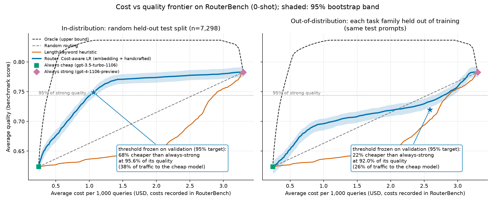

# Cost-aware LLM router



A small classifier decides, per query and before any generation, whether to call a cheap LLM or a
strong one. This repo measures the cost vs quality frontier of several such routers against
baselines on [RouterBench](https://huggingface.co/datasets/withmartian/routerbench), and ships the
best one as an OpenAI-compatible proxy with request logging and a dashboard.

**Result in one paragraph.** On RouterBench (GPT-3.5-turbo vs GPT-4-turbo, 36,497 prompts), a
logistic-regression router over a MiniLM embedding, 21 handcrafted features and a predicted-cost
term kept **95.6% of GPT-4 quality at 67.8% lower cost on the in-distribution test split**
(threshold frozen on validation; +8.2 quality points over random routing at the same cost).
**It did not generalize to unseen task types:** when each task family was held out of training, the
same recipe kept 92.0% of quality at a 21.6% cost cut, which is 2.6 points *worse* than random
routing at the same cost. Both numbers are on the same 7,298 test prompts and have bootstrap CIs
in the tables below.

## What the experiments say

1. **Most of the in-distribution saving comes from knowing which prompts are expensive, not which
   are hard.** A baseline with no quality model at all, which only predicts the strong model's
   extra cost per prompt, gets a 66.5% cost cut at the 95% target (ID test), almost the same as the
   full router's 67.8%. One task family (GSM8K) carries roughly half of the GPT-4 bill while GPT-4
   is only about 5 points better on it, so the router sends all of it to the cheap model.
2. **A plain "does this need the strong model?" classifier is no better than random at matched
   cost.** Embedding + logistic regression gets APGR 0.637 (random is 0.5) when you count calls,
   but at its 95% operating point its quality lift over random routing at the same dollar cost is
   -0.01 points [-0.56, +0.48] (ID test), because the prompts it sends to the strong model are the
   expensive ones.
3. **Routers learn the dataset more than the difficulty.** Held-out task families (OOD) push every
   learned router to or below random routing at matched cost. The cost-only baseline is exactly at
   random (+0.00 points), and the plain classifier is 5.6 points below. Calibration degrades too:
   ECE 0.015 in distribution vs 0.110 OOD.
4. The headline router was fixed before the final run; the cost exponent and all thresholds are
   chosen on validation data only.

<!-- RESULTS:START -->
_Generated by `python scripts/reproduce.py` on 2026-11-15; do not edit by hand._

Benchmark: RouterBench 0-shot (withmartian/routerbench), pair `gpt-3.5-turbo-1106` (cheap) vs `gpt-4-1106-preview` (strong); 36,497 prompts, split 21,900/7,299/7,298 train/val/test. On the test split always-cheap scores 0.624 and always-strong 0.783 (cheap = 79.7% of strong quality) and the strong model costs 13.6x more per query. Brackets are 95% bootstrap CIs over test prompts (1000 resamples). Router: Cost-aware LR (embedding + handcrafted). ID and OOD rows use the same 7,298 test prompts.

### Headline: deployed operating points

| Target (set on validation) | Split | Quality retained vs always-strong | Cost saving vs always-strong | Traffic to cheap model | Quality lift vs random routing at the same cost (points) |
|---|---|---|---|---|---|
| 95% of strong quality | ID test | 95.6% [95.0, 96.3] | 67.8% [66.7, 68.8] | 37.6% [36.5, 38.7] | +8.23 [+7.58, +8.97] |
| 95% of strong quality | OOD (leave-one-family-out) | 92.0% [91.1, 92.8] | 21.6% [20.4, 22.9] | 25.7% [24.8, 26.7] | -2.59 [-3.13, -2.06] |
| 90% of strong quality | ID test | 90.9% [90.0, 91.8] | 77.1% [76.3, 77.9] | 56.5% [55.3, 57.6] | +6.13 [+5.47, +6.86] |
| 90% of strong quality | OOD (leave-one-family-out) | 87.7% [86.6, 88.7] | 42.1% [40.4, 43.6] | 47.8% [46.6, 49.0] | -2.40 [-2.98, -1.85] |

### Routers and baselines: frontier metrics, in-distribution test split

| Router | Split | APGR (random = 0.5) | AUC cost-quality | CPT(50%) | CPT(80%) | Cost saving @95% quality (test sweep) | Cost saving @90% quality (test sweep) | Quality retained at 50% of strong-only cost |
|---|---|---|---|---|---|---|---|---|
| Random | ID test | 0.498 [0.479, 0.518] | 0.703 [0.695, 0.711] | 49.5% [46.0, 52.9] | 79.6% [76.7, 83.0] | 23.1% [20.1, 25.7] | 46.3% [41.6, 50.9] | 89.2% [88.2, 90.2] |
| Length/keyword heuristic | ID test | 0.520 [0.503, 0.537] | 0.669 [0.661, 0.678] | 46.8% [44.7, 49.2] | 66.2% [63.8, 71.4] | 13.3% [11.4, 15.1] | 21.1% [18.8, 23.3] | 82.3% [81.0, 83.4] |
| LR (handcrafted only) | ID test | 0.624 [0.605, 0.643] | 0.712 [0.704, 0.721] | 34.4% [29.2, 38.9] | 65.4% [60.9, 70.1] | 18.9% [16.9, 20.4] | 48.8% [37.9, 64.5] | 90.0% [89.0, 90.9] |
| LR (embedding) | ID test | 0.634 [0.614, 0.653] | 0.719 [0.711, 0.727] | 28.1% [25.5, 31.9] | 67.3% [64.0, 70.2] | 21.6% [17.7, 30.4] | 64.1% [57.4, 70.5] | 92.0% [90.9, 92.9] |
| LR (embedding + handcrafted) | ID test | 0.637 [0.618, 0.656] | 0.720 [0.712, 0.728] | 28.3% [25.5, 31.3] | 66.9% [62.7, 70.4] | 23.2% [18.5, 29.7] | 65.9% [59.5, 71.2] | 92.2% [91.3, 93.1] |
| LR (embedding + handcrafted), both-fail rows dropped from training | ID test | 0.645 [0.627, 0.665] | 0.726 [0.718, 0.734] | 27.6% [25.4, 30.0] | 63.4% [60.2, 68.5] | 32.2% [26.3, 41.0] | 71.6% [66.9, 75.2] | 93.5% [92.6, 94.3] |
| Gap regression, ridge (embedding + handcrafted) | ID test | 0.673 [0.655, 0.691] | 0.746 [0.738, 0.753] | 25.3% [23.5, 27.7] | 57.2% [52.8, 60.2] | 66.0% [62.3, 69.1] | 77.6% [75.9, 79.3] | 97.1% [96.6, 97.7] |
| kNN, k=40 (embedding) | ID test | 0.667 [0.649, 0.686] | 0.745 [0.737, 0.752] | 26.7% [24.3, 29.5] | 58.5% [53.7, 62.1] | 64.7% [59.1, 66.5] | 76.9% [74.9, 78.8] | 96.8% [96.2, 97.4] |
| MLP (embedding + handcrafted) | ID test | 0.628 [0.608, 0.647] | 0.717 [0.709, 0.725] | 30.0% [26.8, 34.2] | 67.1% [63.4, 71.4] | 20.9% [18.3, 26.3] | 61.4% [51.8, 68.8] | 91.2% [90.2, 92.2] |
| Cost only: predicted cost, no quality model (embedding + handcrafted) | ID test | 0.516 [0.499, 0.533] | 0.750 [0.742, 0.758] | 51.5% [49.2, 53.1] | 67.0% [65.2, 69.0] | 68.6% [66.9, 70.0] | 77.1% [75.6, 78.9] | 98.6% [98.2, 98.9] |
| Cost-aware LR (embedding + handcrafted) | ID test | 0.603 [0.586, 0.620] | 0.753 [0.745, 0.761] | 39.6% [36.6, 42.4] | 63.8% [61.1, 65.8] | 69.5% [67.6, 71.2] | 78.5% [77.0, 80.5] | 98.6% [98.3, 98.9] |
| Oracle (quality gap only) | ID test | 1.184 [1.144, 1.228] | 0.821 [0.815, 0.828] | 8.0% [7.5, 8.5] | 12.7% [11.9, 13.6] | 86.3% [85.7, 87.0] | 88.3% [87.8, 89.0] | 106.9% [106.2, 107.5] |
| Oracle (gain per dollar, upper bound) | ID test | 1.184 [1.144, 1.228] | 0.825 [0.818, 0.831] | 8.0% [7.5, 8.5] | 12.7% [11.9, 13.6] | 88.6% [88.0, 89.1] | 90.5% [90.1, 90.8] | 106.9% [106.2, 107.5] |

### Same metrics out of distribution (leave-one-task-family-out, pooled over the same test prompts)

| Router | Split | APGR (random = 0.5) | AUC cost-quality | CPT(50%) | CPT(80%) | Cost saving @95% quality (test sweep) | Cost saving @90% quality (test sweep) | Quality retained at 50% of strong-only cost |
|---|---|---|---|---|---|---|---|---|
| Length/keyword heuristic | OOD (LOFO) | 0.520 [0.503, 0.537] | 0.669 [0.661, 0.678] | 46.8% [44.7, 49.2] | 66.2% [63.8, 71.4] | 13.3% [11.4, 15.1] | 21.1% [18.8, 23.3] | 82.3% [81.0, 83.4] |
| LR (handcrafted only) | OOD (LOFO) | 0.544 [0.526, 0.564] | 0.690 [0.682, 0.699] | 49.6% [46.1, 52.5] | 72.6% [69.6, 75.9] | 13.7% [12.1, 15.5] | 22.2% [19.8, 24.8] | 86.6% [85.4, 87.6] |
| LR (embedding) | OOD (LOFO) | 0.429 [0.411, 0.445] | 0.662 [0.653, 0.671] | 58.5% [55.8, 61.2] | 82.4% [80.3, 83.9] | 8.8% [7.6, 10.6] | 18.8% [17.0, 20.8] | 80.9% [79.7, 82.1] |
| LR (embedding + handcrafted) | OOD (LOFO) | 0.432 [0.414, 0.449] | 0.665 [0.656, 0.673] | 58.8% [55.9, 62.0] | 82.0% [80.4, 84.1] | 9.4% [8.3, 10.8] | 19.3% [17.2, 21.2] | 81.5% [80.3, 82.7] |
| Gap regression, ridge (embedding + handcrafted) | OOD (LOFO) | 0.462 [0.446, 0.478] | 0.673 [0.664, 0.681] | 55.4% [53.0, 57.9] | 80.4% [77.8, 82.5] | 13.3% [11.4, 15.1] | 23.5% [21.6, 25.6] | 82.4% [81.1, 83.5] |
| kNN, k=40 (embedding) | OOD (LOFO) | 0.429 [0.413, 0.447] | 0.665 [0.656, 0.674] | 59.2% [55.8, 61.9] | 81.9% [80.0, 84.1] | 10.2% [8.9, 11.6] | 19.5% [17.7, 21.7] | 81.5% [80.3, 82.7] |
| Cost only: predicted cost, no quality model (embedding + handcrafted) | OOD (LOFO) | 0.473 [0.454, 0.491] | 0.728 [0.720, 0.736] | 52.6% [50.8, 55.0] | 82.6% [79.3, 84.8] | 36.9% [28.5, 47.7] | 72.4% [70.5, 74.8] | 94.1% [93.3, 94.8] |
| Cost-aware LR (embedding + handcrafted) | OOD (LOFO) | 0.456 [0.436, 0.476] | 0.712 [0.704, 0.721] | 55.2% [51.3, 60.8] | 86.9% [85.3, 88.6] | 15.7% [13.0, 18.3] | 60.3% [50.6, 68.7] | 91.0% [90.1, 91.8] |

### Deployed 95% operating point for every router, ID vs OOD

| Router | Split | Quality retained | Cost saving | Lift vs random at same cost (points) |
|---|---|---|---|---|
| Length/keyword heuristic | ID test | 96.5% [95.8, 97.2] | 8.8% [8.1, 9.7] | -1.18 [-1.70, -0.71] |
| Length/keyword heuristic | OOD (LOFO) | 94.8% [93.9, 95.5] | 10.6% [9.9, 11.5] | -2.28 [-2.90, -1.73] |
| LR (handcrafted only) | ID test | 96.1% [95.4, 96.8] | 16.1% [14.8, 17.3] | -0.28 [-0.81, +0.23] |
| LR (handcrafted only) | OOD (LOFO) | 90.9% [90.0, 91.8] | 19.8% [18.6, 21.0] | -3.71 [-4.32, -3.10] |
| LR (embedding) | ID test | 95.0% [94.2, 95.8] | 21.6% [20.3, 22.9] | -0.20 [-0.74, +0.29] |
| LR (embedding) | OOD (LOFO) | 87.9% [86.8, 89.0] | 22.7% [21.7, 23.9] | -5.54 [-6.26, -4.87] |
| LR (embedding + handcrafted) | ID test | 95.1% [94.3, 95.8] | 22.4% [21.1, 23.7] | -0.01 [-0.56, +0.48] |
| LR (embedding + handcrafted) | OOD (LOFO) | 87.5% [86.4, 88.6] | 24.3% [23.1, 25.6] | -5.58 [-6.25, -4.94] |
| LR (embedding + handcrafted), both-fail rows dropped from training | ID test | 95.4% [94.7, 96.1] | 27.8% [26.4, 29.2] | +1.21 [+0.70, +1.70] |
| Gap regression, ridge (embedding + handcrafted) | ID test | 95.2% [94.5, 95.9] | 65.2% [64.0, 66.2] | +7.44 [+6.80, +8.10] |
| Gap regression, ridge (embedding + handcrafted) | OOD (LOFO) | 91.9% [91.1, 92.8] | 20.0% [18.7, 21.2] | -2.88 [-3.47, -2.30] |
| kNN, k=40 (embedding) | ID test | 95.4% [94.6, 96.1] | 61.7% [60.4, 63.0] | +6.96 [+6.30, +7.67] |
| kNN, k=40 (embedding) | OOD (LOFO) | 94.5% [93.7, 95.3] | 11.2% [10.4, 12.1] | -2.39 [-2.92, -1.84] |
| MLP (embedding + handcrafted) | ID test | 95.9% [95.2, 96.5] | 18.2% [17.1, 19.5] | -0.11 [-0.63, +0.35] |
| Cost only: predicted cost, no quality model (embedding + handcrafted) | ID test | 95.9% [95.2, 96.5] | 66.5% [65.4, 67.5] | +8.19 [+7.52, +8.95] |
| Cost only: predicted cost, no quality model (embedding + handcrafted) | OOD (LOFO) | 91.2% [90.3, 92.1] | 40.1% [38.7, 41.7] | +0.00 [-0.57, +0.60] |
| Cost-aware LR (embedding + handcrafted) | ID test | 95.6% [95.0, 96.3] | 67.8% [66.7, 68.8] | +8.23 [+7.58, +8.97] |
| Cost-aware LR (embedding + handcrafted) | OOD (LOFO) | 92.0% [91.1, 92.8] | 21.6% [20.4, 22.9] | -2.59 [-3.13, -2.06] |

### Per task family (headline router, 95% target)

| Task family | n test | Cheap | Strong | Within-family APGR, plain LR, ID | Within-family APGR, plain LR, OOD | Within-family APGR, heuristic | Router quality ID | To strong ID | Router quality OOD | To strong OOD |
|---|---|---|---|---|---|---|---|---|---|---|
| arc | 294 | 0.847 | 0.969 | 0.592 | 0.582 | 0.580 | 0.959 | 90% | 0.963 | 91% |
| chinese | 157 | 0.287 | 0.503 | 0.561 | 0.441 | 0.484 | 0.465 | 73% | 0.363 | 43% |
| gsm8k | 1490 | 0.604 | 0.658 | 0.573 | 0.425 | 0.536 | 0.604 | 0% | 0.653 | 96% |
| hellaswag | 2009 | 0.598 | 0.837 | 0.612 | 0.443 | 0.640 | 0.794 | 86% | 0.653 | 43% |
| mbpp | 85 | 0.635 | 0.635 | 0.000 | 0.000 | 0.000 | 0.635 | 1% | 0.624 | 95% |
| misc | 185 | 0.580 | 0.599 | 0.697 | 0.720 | 1.372 | 0.585 | 2% | 0.585 | 2% |
| mmlu | 2808 | 0.652 | 0.818 | 0.638 | 0.537 | 0.598 | 0.794 | 78% | 0.800 | 88% |
| mtbench | 16 | 0.744 | 0.906 | 0.663 | 0.620 | 0.483 | 0.744 | 0% | 0.750 | 6% |
| winogrande | 254 | 0.594 | 0.823 | 0.524 | 0.524 | 0.479 | 0.823 | 100% | 0.819 | 95% |

Within-family APGR ranks prompts inside one task family only (0.5 = random), so it measures difficulty prediction rather than dataset identification. Test-size-weighted mean over arc, chinese, gsm8k, hellaswag, mmlu, winogrande (families with n >= 150 and a real quality gap), plain LR: 0.609 in distribution, 0.486 when the family was held out of training; length/keyword heuristic: 0.589. The 'Router quality' and 'To strong' columns are the headline cost-aware router at its 95% operating point.

### Calibration and overhead

- Calibration of P(needs strong), LR (embedding + handcrafted): ECE 0.015 on ID test, 0.110 OOD (LOFO); base rate 0.251.
- Routing overhead (embed + features + classify, single query, in-process, CPU `Intel64 Family 6 Model 140 Stepping 1, GenuineIntel`): p50 52.3 ms, p95 108.4 ms over 300 test prompts.

### Robustness to surface perturbations (ID test subset)

Clean APGR on the 1,500-prompt subset: 0.593.

| Perturbation | APGR | Routes flipped at the 95% threshold | Mean abs change in P | Quality retained (clean -> perturbed) | Cost saving (clean -> perturbed) |
|---|---|---|---|---|---|
| typos_5pct | 0.593 | 13.3% | 0.067 | 95.5% -> 93.8% | 67.4% -> 72.9% |
| lowercase | 0.595 | 1.2% | 0.009 | 95.5% -> 95.4% | 67.4% -> 67.9% |
| polite_filler | 0.589 | 6.5% | 0.034 | 95.5% -> 94.3% | 67.4% -> 70.1% |

### Stretch: budget-constrained online policy (simulated on the ID test stream)

| Target share to strong | Realised share | Quality retained | Cost saving | Lift vs random (points) | Quality retained, hindsight threshold at same share |
|---|---|---|---|---|---|
| 20% | 20.4% | 85.5% | 86.5% | +3.52 | 85.6% |
| 40% | 40.2% | 89.8% | 78.5% | +5.49 | 90.0% |
| 60% | 59.8% | 95.1% | 69.2% | +8.02 | 95.1% |

### Other model pairs (same splits and features, ID test)

| Pair (cheap -> strong) | Cheap / strong quality (ID test) | APGR (ID test) | Quality retained @95% target | Cost saving @95% target | Lift vs random (points) |
|---|---|---|---|---|---|
| mistralai/mixtral-8x7b-chat -> gpt-4-1106-preview | 0.549 / 0.783 | 0.596 [0.584, 0.609] | 95.2% [94.6, 95.7] | 65.3% [64.1, 66.4] | +12.16 [+11.47, +12.91] |
| claude-instant-v1 -> claude-v2 | 0.599 / 0.632 | 0.563 [0.477, 0.640] | 95.6% [94.3, 97.1] | 87.8% [87.5, 88.0] | +0.45 [+0.13, +0.77] |

### Resume bullets (filled from the numbers above)

- Built a cost-aware LLM router (MiniLM sentence embedding + handcrafted features + logistic regression with a predicted-cost term) retaining 95.6% of strong-model accuracy while routing 38% of traffic to a cheaper model, cutting cost 68% on RouterBench (gpt-3.5-turbo-1106 vs gpt-4-1106-preview, in-distribution test split, n=7,298; +8.2 quality points vs random routing at equal cost). Leave-one-task-family-out evaluation showed the gain does not transfer to unseen task types (92.0% quality at a 22% cost cut, -2.6 points vs random), reported with bootstrap CIs.
- Deployed as an OpenAI-compatible FastAPI proxy with 108 ms p95 routing overhead (CPU, in-process), request logging, and a cost/quality dashboard.
<!-- RESULTS:END -->

More figures: [all routers](assets/frontier_all_routers.png),
[reliability ID](assets/reliability_id.png), [reliability OOD](assets/reliability_ood.png),
[per task family](assets/per_task.png). Raw numbers: [results/results.json](results/results.json).

## Quickstart

```bash
python -m venv .venv
.venv/Scripts/activate                 # Windows; on Linux/macOS: source .venv/bin/activate
pip install torch --index-url https://download.pytorch.org/whl/cpu
pip install -r requirements.txt

python scripts/demo.py                 # routing proxy demo, mock LLM backend, no keys needed
python -m pytest -q                    # tests: synthetic data + hashing embedder, no network
python scripts/reproduce.py            # regenerates every number, table and figure above
```

`scripts/demo.py` uses the committed router artifact and finishes in well under two minutes. Its
first run downloads the MiniLM embedding model (about 90 MB) from Hugging Face; pass
`--embedder hashing` only to smoke-test without any download (routing decisions are then
meaningless, because the artifact was trained on MiniLM features).

`scripts/reproduce.py` downloads RouterBench (about 100 MB, no token needed), embeds 36,497 prompts
on CPU once (cached under `data/cache/`, roughly 10 to 40 minutes on a laptop) and then takes about
10 minutes. `--quick` uses fewer bootstrap resamples and skips the MLP and robustness steps.

## How it works

```
client -> router service (FastAPI, OpenAI-compatible /v1/chat/completions)
            |-- featurizer: MiniLM sentence embedding (head + tail of the prompt) + 21 handcrafted features
            |-- router: one linear head = logit P(needs strong) - alpha * predicted log extra cost
            |-- policy: fixed threshold (calibrated offline) or online budget policy
            |-- dispatcher -> cheap LLM / strong LLM (mock, OpenAI-compatible, or Anthropic backend)
            `-- logger: SQLite (prompt hash, route, score, latency, tokens, cost, counterfactual cost)
dashboard (Streamlit): cost vs always-strong, route mix, latency, offline quality estimate
```

* **Data and labels.** RouterBench 0-shot gives every model's score and dollar cost on every prompt,
  so routers are trained and evaluated without paying for calls. `needs_strong = (strong_score -
  cheap_score) > 0`. Prompts where both models fail carry no routing signal; a variant that drops
  them from training is reported.
* **Splits.** In-distribution: 60/20/20 random split, stratified by task family, duplicate prompts
  kept together. OOD: leave-one-task-family-out, where the model and its threshold never see the
  held-out family; predictions are pooled so ID and OOD are compared on the same test prompts.
* **Evaluation harness** (`router/eval/`, built before any router): always-cheap, always-strong,
  random routing at matched cost, a training-free length/keyword heuristic, two oracles, frontier
  metrics (APGR, cost-quality AUC, CPT, cost at 95%/90% of strong quality, quality at half budget),
  deployed operating points with thresholds frozen on validation, bootstrap CIs, calibration (ECE),
  per-family breakdown, surface-perturbation robustness and routing overhead.
* **Routers** (`router/models/`): logistic regression on embeddings, on handcrafted features, on
  both; ridge regression of the quality gap; kNN; MLP; and the cost-aware logistic router.
* Interfaces and schemas: [docs/ARCHITECTURE.md](docs/ARCHITECTURE.md). Original plan:
  [docs/PLAN.md](docs/PLAN.md).

## Serving

```bash
# mock backend (default): no keys, canned answers, real routing decisions
uvicorn router.serve.app:get_app --factory --port 8000
curl -s localhost:8000/v1/chat/completions -H "content-type: application/json" \
  -d '{"model":"auto","messages":[{"role":"user","content":"What is 17 + 25?"}]}'
streamlit run router/dashboards/app.py

# real providers: copy .env.example to .env and set the backend, models, keys and prices
ROUTER_BACKEND=openai CHEAP_MODEL=... STRONG_MODEL=... OPENAI_API_KEY=... uvicorn router.serve.app:get_app --factory

docker compose up --build              # router on :8000, dashboard on :8501
```

`model: "auto"` routes; `"cheap"` / `"strong"` force a tier. Every response carries a `router`
object (`route`, score, threshold, policy, overhead) and an `x-router-route` header. The header
`x-router-threshold` overrides the threshold per request, and `ROUTER_POLICY=budget` switches to an
online policy that tracks a target share of strong calls. The value the service calls `p_strong` is
the cost-adjusted routing score in (0, 1), not a calibrated probability. Only a SHA-256 hash of the
prompt is logged, never its text.

## What was not validated against live APIs

No API keys were available while building this, so:

* **Live LLM calls were never made.** The OpenAI-compatible and Anthropic backends are tested only
  against mocked HTTP transports. The demo and the end-to-end tests use the mock backend.
* **No own holdout set.** The plan's self-collected prompts answered by a current model pair were
  not generated, so there is no evidence about today's models.
* **No LLM judge.** Open-ended chat quality with a position-swapped judge was not run; all quality
  numbers are RouterBench's own automatic scores.
* **RouteLLM / LMSYS preference data was not used**, and RouteLLM's published routers (MF, BERT)
  were not reproduced; the kNN router is a reimplementation in the style of the RouterBench paper.
* **`docker compose up` was written but not built or run** on the development machine.
* **The fine-tuned encoder is implemented (`router/models/finetune.py`, `--finetune`) but was not
  run** (CPU-only machine), so no number is reported for it.
* Dollar figures in the serving layer use the price table in `configs/default.yaml` (dated); the
  benchmark numbers use the per-prompt costs recorded in RouterBench in early 2024.

## Limitations

* **The headline saving is in-distribution and benchmark-specific.** It depends on a cost structure
  where one task family is expensive for the strong model and gains little from it. Traffic without
  that structure should expect much less, and the OOD rows are the better guide for new task types.
* **OOD routing is at or below random at matched cost.** Within a task family the plain
  classifier's ranking of prompts is modest in distribution (within-family APGR 0.609, random is
  0.5) and gone when the family is held out (0.486), so the router is mostly identifying the dataset.
* **Free-form prompts are out of distribution too.** The router was trained on benchmark-templated
  prompts. On the hand-written prompts in `scripts/demo.py` its choices are not sensible (for
  example it sends "What is 17 + 25?" to the strong model and a proof request to the cheap one).
  Retrain on your own traffic before using it for anything real.
* **Old model pair.** GPT-3.5-turbo-1106 vs GPT-4-1106-preview with 2024 prices. Quality gaps and
  price ratios of current models differ.
* **Benchmark, not user traffic.** Mostly multiple-choice and short-answer tasks with templated
  prompts; little open-ended chat or code. Contamination and saturation of these evals are likely.
* **Pooled OOD scores come from nine different fold models**, so the pooled OOD frontier curve is
  an approximation; the deployed operating points use per-fold thresholds and are the cleaner number.
* **Robustness tests are surface-level** (typos, lowercasing, polite filler). No paraphrase or
  adversarial "easy-looking hard prompt" set was built.
* **Routing overhead was measured in-process on one laptop CPU** while other work was running; it is
  dominated by the MiniLM forward pass and is not a server benchmark.
* Stretch items not done: three-tier routing, cascading, drift monitoring. The budget policy is
  evaluated only in simulation on the test stream.

## Repo layout

```
router/data  router/features  router/models  router/eval  router/serve  router/dashboards
configs/  scripts/reproduce.py  scripts/demo.py  tests/  artifacts/  assets/  results/  docs/
```

## License and data

Code: MIT (see [LICENSE](LICENSE)). RouterBench is downloaded at run time from
`withmartian/routerbench` and is not redistributed here; its dataset card states no license, so
check its terms before reusing the data. RouterBench: Hu et al., 2024, "RouterBench: A Benchmark for
Multi-LLM Routing System".
